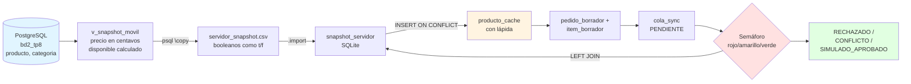

# Design — TP8 Food Store: Base SQLite y Semáforo de Sincronización

**Proyecto:** Trabajo Práctico N.º 8 — Base de Datos II  
**Grupo:** Belén Calvo, Elías Tello, Hernán González, Bruno Fiouchetta  
**Fecha:** Noviembre 2026

---

## 1. Arquitectura del Sistema

PostgreSQL es la **fuente de verdad** y SQLite opera como caché local con capacidad offline. La sincronización tiene dos movimientos: **bajar** la instantánea del catálogo (servidor → tablet) y **subir** las solicitudes pendientes para validarlas (tablet → servidor; en el TP solo se simula con el semáforo).



**Flujo de datos:**
1. **Exportación:** PostgreSQL genera la vista `v_snapshot_movil` con precios convertidos a centavos y el campo `disponible` calculado como `activo AND stock > 0`.
2. **Importación:** El CSV se importa en `snapshot_servidor` y se carga en `producto_cache` mediante upsert (actualiza sin borrar filas).
3. **Offline:** La tablet consulta `v_catalogo_disponible` y crea borradores locales que se encolan en `cola_sync` con estado `PENDIENTE`.
4. **Simulación:** El semáforo compara cada solicitud pendiente contra la instantánea y actualiza el estado sin modificar PostgreSQL.

---

## 2. Modelo de Datos SQLite

### 2.1 Tablas STRICT

Todas las tablas usan `STRICT` y requieren `PRAGMA foreign_keys = ON;` en cada conexión.

#### `snapshot_servidor`
Copia exacta del CSV generado por PostgreSQL. Los booleanos llegan como `'t'` / `'f'` (texto).

```
producto_id     INTEGER PRIMARY KEY
nombre          TEXT    NOT NULL
precio_centavos INTEGER NOT NULL CHECK (precio_centavos >= 0)
stock           INTEGER NOT NULL CHECK (stock >= 0)
disponible      TEXT    NOT NULL CHECK (disponible IN ('t','f'))
eliminado       TEXT    NOT NULL CHECK (eliminado  IN ('t','f'))
capturado_en    TEXT    NOT NULL
```

#### `producto_cache`
Copia del catálogo en la tablet, **incluidos los productos dados de baja** (lápidas). Los booleanos se convierten a INTEGER (0/1).

```
producto_id      INTEGER PRIMARY KEY
nombre           TEXT    NOT NULL
precio_centavos  INTEGER NOT NULL CHECK (precio_centavos >= 0)
stock_visto      INTEGER NOT NULL CHECK (stock_visto >= 0)
disponible_visto INTEGER NOT NULL CHECK (disponible_visto IN (0,1))
eliminado        INTEGER NOT NULL DEFAULT 0 CHECK (eliminado IN (0,1))
capturado_en     TEXT    NOT NULL
```

**Lápida:** cuando un producto se da de baja, la fila **no se borra**; se actualiza `eliminado = 1` para conservar la referencia en `item_borrador`.

#### `pedido_borrador`
Cabecera del pedido armado offline.

```
id_local            TEXT    PRIMARY KEY
usuario_id_servidor INTEGER NOT NULL
forma_pago          TEXT    NOT NULL CHECK (forma_pago IN ('EFECTIVO','TARJETA','TRANSFERENCIA'))
creado_en           TEXT    NOT NULL DEFAULT (strftime('%Y-%m-%dT%H:%M:%SZ','now'))
```

#### `item_borrador`
Líneas de detalle del borrador. Clave primaria compuesta (un producto por borrador).

```
id_local              TEXT    NOT NULL REFERENCES pedido_borrador(id_local) ON DELETE CASCADE
producto_id           INTEGER NOT NULL REFERENCES producto_cache(producto_id)
cantidad              INTEGER NOT NULL CHECK (cantidad > 0)
precio_centavos_visto INTEGER NOT NULL CHECK (precio_centavos_visto >= 0)
PRIMARY KEY (id_local, producto_id)
```

#### `cola_sync`
Cola de sincronización con control de estados.

```
solicitud_uuid TEXT PRIMARY KEY
id_local       TEXT NOT NULL REFERENCES pedido_borrador(id_local)
estado         TEXT NOT NULL DEFAULT 'PENDIENTE' 
               CHECK (estado IN ('PENDIENTE','CONFLICTO','RECHAZADO','SIMULADO_APROBADO'))
motivo         TEXT
creada_en      TEXT NOT NULL DEFAULT (strftime('%Y-%m-%dT%H:%M:%SZ','now'))
```

### 2.2 Índice Parcial

Garantiza que un borrador no tenga dos solicitudes pendientes simultáneas (permite reenvíos tras resolver conflictos).

```sql
CREATE UNIQUE INDEX ux_cola_una_pendiente 
ON cola_sync (id_local) 
WHERE estado = 'PENDIENTE';
```

**Alternativa descartada:** `UNIQUE` total sobre `id_local` → impediría el reenvío legítimo después de un conflicto de precio (REQ-01, caso C2).

### 2.3 Vista del Catálogo

Muestra solo productos disponibles para venta offline (C1).

```sql
CREATE VIEW v_catalogo_disponible AS
SELECT producto_id, 
       nombre, 
       precio_centavos / 100.0 AS precio, 
       stock_visto
FROM producto_cache
WHERE eliminado = 0 AND disponible_visto = 1;
```

---

## 3. Lógica del Semáforo

El semáforo evalúa cada solicitud `PENDIENTE` comparando los ítems del borrador contra `snapshot_servidor`.

### 3.1 Reglas de Evaluación

| Luz | Estado | Condición |
|:---:|---|---|
| 🔴 **Rojo** | `RECHAZADO` | Producto inexistente en la instantánea **OR** `disponible = 'f'` **OR** `eliminado = 't'` **OR** `cantidad > stock` |
| 🟡 **Amarillo** | `CONFLICTO` | No hay rojo **AND** `precio_centavos_visto ≠ precio_centavos` |
| 🟢 **Verde** | `SIMULADO_APROBADO` | No hay rojo ni amarillo |

**Precedencia:** Si una solicitud tiene ítems en rojo y en amarillo, **gana el rojo** (se marca `RECHAZADO`).

### 3.2 Implementación

```text
-- Pseudocódigo del semáforo
FOR cada solicitud WHERE estado = 'PENDIENTE':
    JOIN item_borrador LEFT JOIN snapshot_servidor
    
    IF EXISTS (producto_id IS NULL OR disponible = 'f' OR eliminado = 't' OR cantidad > stock):
        estado = 'RECHAZADO'
        motivo = 'producto {id}: {causa específica}'
    
    ELSE IF EXISTS (precio_centavos_visto <> precio_centavos):
        estado = 'CONFLICTO'
        motivo = 'precio cambió: producto {id}'
    
    ELSE:
        estado = 'SIMULADO_APROBADO'
        motivo = NULL
    
    UPDATE cola_sync SET estado, motivo
```

**Idempotencia:** Solo se procesan solicitudes `PENDIENTE`. Las ya evaluadas conservan su estado (REQ-03).

**Trampas:**
- Con `LEFT JOIN`, si el producto no existe en la instantánea, `snapshot_servidor.*` es `NULL`. Hay que verificar `producto_id IS NULL` explícitamente (no confiar en `cantidad > stock` porque `NULL > n` da `NULL`).
- Los booleanos en `snapshot_servidor` son `'t'`/`'f'` (texto), no 0/1.

---

## 4. Decisiones de Diseño Documentadas

### 4.1 Cálculo de `disponible`

**Decisión:** `disponible = (activo AND stock > 0)`

La vista `v_snapshot_movil` en PostgreSQL calcula el campo `disponible` combinando la baja lógica y el stock:

```sql
(p.activo AND p.stock > 0) AS disponible
```

**Alternativa descartada:** Enviar `activo` y `stock` por separado y calcular en SQLite.

**Motivo:** La conversión se hace una vez en el servidor; SQLite recibe el dato listo. Reduce lógica en la tablet y facilita el semáforo (una sola columna en vez de dos).

---

### 4.2 Carga del Caché con Upsert y Lápida

**Decisión:** `INSERT ... ON CONFLICT DO UPDATE` sin borrar filas previas.

Cuando un producto se da de baja (`activo = false`), la instantánea trae `eliminado = 't'` y el upsert **actualiza** la fila en `producto_cache` marcando `eliminado = 1`.

**Alternativa descartada:** `DELETE FROM producto_cache` seguido de `INSERT`.

**Motivo:** Si se borra la fila, la clave foránea en `item_borrador` falla o deja huérfanos. La lápida conserva la referencia histórica y permite que el borrador existente siga válido para auditoría. El producto desaparece de `v_catalogo_disponible` pero la fila permanece en el caché (C4).

---

### 4.3 Índice Único Parcial

**Decisión:** `CREATE UNIQUE INDEX ... WHERE estado = 'PENDIENTE'`

El índice único solo aplica a solicitudes pendientes. Una vez resuelta (en `CONFLICTO`, `RECHAZADO` o `SIMULADO_APROBADO`), el borrador puede generar una nueva solicitud con UUID distinto.

**Alternativa descartada:** `UNIQUE (id_local)` total en la tabla.

**Motivo:** Impediría el flujo de C2 (conflicto de precio → cliente acepta → nuevo envío con precio actualizado). El índice parcial bloquea envíos duplicados simultáneos pero permite reintentos legítimos.

---

### 4.4 Formato de Booleanos en `snapshot_servidor`

**Decisión:** Columnas `disponible` y `eliminado` como `TEXT` con `CHECK IN ('t','f')`

El comando `\copy` de PostgreSQL exporta booleanos como texto (`t` / `f`), no como `1` / `0`. La tabla `snapshot_servidor` respeta ese formato para que `.import --csv` funcione sin transformaciones.

**Alternativa descartada:** Importar como INTEGER directamente.

**Motivo:** SQLite no convierte `'t'` a `1` automáticamente. Sería necesario un paso intermedio de limpieza con `sed` o Python. Más simple: aceptar el texto en `snapshot_servidor` y convertir a INTEGER en el upsert hacia `producto_cache`.

---

### 4.5 ROLLBACK Explícito en C7

**Decisión:** Probar `BEGIN; INSERT (válidos); INSERT (inválido); ROLLBACK;` y verificar con `SELECT COUNT(*)` que las tres tablas tienen la misma cantidad de filas que antes (REQ-04).

En SQLite, una restricción `CHECK` o `FOREIGN KEY` que falla deshace **solo la sentencia** que falló. Las sentencias anteriores de la misma transacción siguen aplicadas y la transacción sigue abierta y válida (no queda "en estado fallido" como en PostgreSQL).

**Alternativa descartada:** Confiar en que el error deshace toda la transacción.

**Motivo:** Si después del error se ejecuta `COMMIT` (o el script sigue y lo hace), quedan guardados un `pedido_borrador` y una solicitud en `cola_sync` sin ítems. El `ROLLBACK` explícito deshace todo y garantiza que no quede ninguna fila nueva (REQ-04). Comprobado en SQLite 3.4x: tras el error de CHECK, la fila insertada antes seguía en la tabla y la transacción seguía abierta.

---

## 5. Fuera de Alcance del Diseño

- **Venta real en PostgreSQL:** El semáforo solo simula. La inserción en `pedido` y `detalle_pedido` la hace un procedimiento `sp_crear_pedido` que vuelve a validar stock con `SELECT ... FOR UPDATE` (no implementado en este TP).
- **Protección definitiva de idempotencia:** Tabla `solicitud_movil` en el servidor con `ON CONFLICT DO NOTHING` (parada 8 del apunte, no se pide).
- **Resolución automática de conflictos:** El sistema no decide solo; marca `CONFLICTO` y la decisión es del cliente. Sí está dentro del alcance el caso en que el cliente **acepta** (C2): se actualiza `precio_centavos_visto` en el borrador y se crea una solicitud nueva (otro UUID), que el semáforo evalúa como `SIMULADO_APROBADO`.
- **Interfaz gráfica:** No se implementa app ni UI; alcanza con SQL en `sqlite3` CLI y `psql`.

---

## 6. Verificación del Diseño

Cada requisito se verifica con casos de prueba:

| Requisito | Caso | Verificación |
|---|:---:|---|
| REQ-01 | C2 | Cambiar precio en `bd2_tp8`, exportar, importar, correr semáforo → `estado = 'CONFLICTO'` |
| REQ-02 | C3, C4 | Borrador con cantidad > stock o producto dado de baja → `estado = 'RECHAZADO'` |
| REQ-03 | C6 | Reintentar con mismo UUID → error de clave primaria; repetir semáforo → mismo resultado |
| REQ-04 | C7 | `INSERT` con cantidad 0 o producto inexistente → error; `SELECT COUNT(*)` sin cambios |

**Consulta final (consigna 2.c):** Correr en `bd2_tp8` antes y después de la simulación:
```sql
SELECT COUNT(*) FROM pedido;
SELECT id_producto, stock FROM producto WHERE id_producto IN (...);
```
Resultado esperado: **sin cambios** (la simulación no modifica el servidor).
