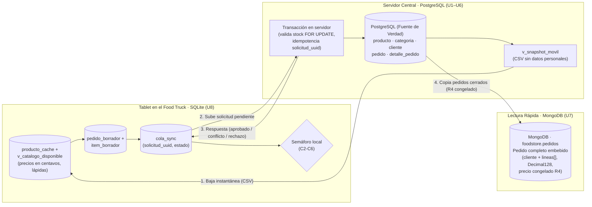

# Consigna 2.c (Casos C2–C6 y Consulta Final) y Consigna 3.a (Mapa de la Capa de Datos)

**Trabajo Práctico N.º 8 — Base de Datos II (Food Store: SQLite y Semáforo de Sincronización)**  
**Responsable:** Hernán González (Bloque C)  
**Archivos asociados:** `postgresql/casos_servidor.sql`, `movil/casos_sqlite.sql`, `evidencias/salida_casos_servidor_postgresql.txt`, `evidencias/salida_casos_c2_c6_sqlite.txt`

---

## 1. Consigna 2.c · Casos de Prueba (C2 a C6) y Consulta Final en PostgreSQL

### 1.1 Consulta inicial en PostgreSQL (`bd2_tp8`) — Antes de la simulación

**Comando (`psql -U postgres -d bd2_tp8`):**
```sql
SELECT count(*) AS total_pedidos_antes FROM pedido;

SELECT id_producto, nombre, precio, stock, activo
FROM producto
WHERE id_producto IN (2, 3, 9, 10, 11)
ORDER BY id_producto;
```

**Resultado:**
```text
 total_pedidos_antes 
---------------------
              200005
(1 fila)

 id_producto |      nombre       | precio  | stock | activo 
-------------+-------------------+---------+-------+--------
           2 | Medialunas x6     | 3200.00 |     3 | t
           3 | Agua mineral 2L   | 1400.00 |    40 | t
           9 | Fideos secos 500g | 1950.00 |    30 | t
          10 | Helado 1L         | 9500.00 |     0 | f
          11 | Cerveza 1L        | 4500.00 |    10 | t
(5 filas)
```

---

### 1.2 Caso C2 · El precio sube en el servidor (`CONFLICTO` → cliente acepta → `SIMULADO_APROBADO`)

**Comando:**
```sql
-- 1) En SQLite (sin señal, con precio inicial de 140000 centavos = $1400,00):
BEGIN;
INSERT INTO pedido_borrador (id_local, usuario_id_servidor, forma_pago, creado_en)
VALUES ('cccccccc-0000-4000-8000-000000000002', 1, 'EFECTIVO', '2026-11-02T10:00:02Z');
INSERT INTO item_borrador (id_local, producto_id, cantidad, precio_centavos_visto)
VALUES ('cccccccc-0000-4000-8000-000000000002', 3, 2, 140000);
INSERT INTO cola_sync (solicitud_uuid, id_local, creada_en)
VALUES ('dddddddd-0000-4000-8000-000000000002', 'cccccccc-0000-4000-8000-000000000002', '2026-11-02T10:00:02Z');
COMMIT;

-- 2) En PostgreSQL (bd2_tp8): sube el precio de Agua mineral 2L a $1600,00 y se exporta nueva instantánea
UPDATE producto SET precio = 1600.00 WHERE id_producto = 3;
\copy (SELECT * FROM v_snapshot_movil ORDER BY producto_id) TO 'movil/servidor_snapshot.csv' CSV HEADER

-- 3) En SQLite: importar instantánea nueva y correr el semáforo
.read movil/importar_catalogo.sql
.read movil/semaforo.sql

-- 4) En SQLite: el cliente acepta el nuevo precio (160000 centavos) y se envía una solicitud nueva (otro UUID)
BEGIN;
UPDATE item_borrador SET precio_centavos_visto = 160000
WHERE id_local = 'cccccccc-0000-4000-8000-000000000002' AND producto_id = 3;
INSERT INTO cola_sync (solicitud_uuid, id_local, creada_en)
VALUES ('dddddddd-0000-4000-8000-000000000202', 'cccccccc-0000-4000-8000-000000000002', '2026-11-02T10:05:00Z');
COMMIT;
.read movil/semaforo.sql
```

**Resultado:**
```text
-- Tras la primera evaluación:
dddddddd-0000-4000-8000-000000000002 | cccccccc-0000-4000-8000-000000000002 | CONFLICTO         | precio cambió: producto 3 (visto 140000, actual 160000 centavos)

-- Tras aceptar el cliente el nuevo precio y evaluar la segunda solicitud:
dddddddd-0000-4000-8000-000000000002 | cccccccc-0000-4000-8000-000000000002 | CONFLICTO         | precio cambió: producto 3 (visto 140000, actual 160000 centavos)
dddddddd-0000-4000-8000-000000000202 | cccccccc-0000-4000-8000-000000000002 | SIMULADO_APROBADO | todo coincide con la instantánea (simulación, no es una venta)
```

**Explicación:** Cuando el precio en la instantánea del servidor (`160000` centavos) no coincide con el que vio la tablet (`140000` centavos), el semáforo marca luz amarilla (`CONFLICTO`) para pedir confirmación al cliente en lugar de decidir solo. Cuando el cliente acepta, se actualiza `precio_centavos_visto` en el borrador y se encola una solicitud nueva con otro `solicitud_uuid` (permitida por el índice parcial `ux_cola_una_pendiente`), que pasa a `SIMULADO_APROBADO` conservando el registro histórico del conflicto previo.

---

### 1.3 Caso C3 · Cantidad mayor que el stock (`RECHAZADO`)

**Comando:**
```sql
-- En SQLite: el borrador pide 5 unidades del producto 2 (Medialunas x6), cuyo stock en el servidor es 3
BEGIN;
INSERT INTO pedido_borrador (id_local, usuario_id_servidor, forma_pago, creado_en)
VALUES ('cccccccc-0000-4000-8000-000000000003', 1, 'TARJETA', '2026-11-02T10:00:03Z');
INSERT INTO item_borrador (id_local, producto_id, cantidad, precio_centavos_visto)
VALUES ('cccccccc-0000-4000-8000-000000000003', 2, 5, 320000);
INSERT INTO cola_sync (solicitud_uuid, id_local, creada_en)
VALUES ('dddddddd-0000-4000-8000-000000000003', 'cccccccc-0000-4000-8000-000000000003', '2026-11-02T10:00:03Z');
COMMIT;
.read movil/semaforo.sql
```

**Resultado:**
```text
dddddddd-0000-4000-8000-000000000003 | cccccccc-0000-4000-8000-000000000003 | RECHAZADO | stock insuficiente: producto 2 (pide 5, hay 3)
```

**Explicación:** Como la cantidad solicitada en el borrador (`5`) supera el stock informado por el servidor en la instantánea (`3`), el semáforo aplica luz roja (`RECHAZADO`) detallando cuántas unidades se pidieron y cuántas hay. El stock real en PostgreSQL (`3` unidades) permanece intacto porque la tablet nunca descuenta stock del servidor.

---

### 1.4 Caso C4 · Producto dado de baja en el servidor (`RECHAZADO` y lápida en caché)

**Comando:**
```sql
-- 1) En SQLite (sin señal, cuando Cerveza 1L estaba disponible):
BEGIN;
INSERT INTO pedido_borrador (id_local, usuario_id_servidor, forma_pago, creado_en)
VALUES ('cccccccc-0000-4000-8000-000000000004', 1, 'TRANSFERENCIA', '2026-11-02T10:00:04Z');
INSERT INTO item_borrador (id_local, producto_id, cantidad, precio_centavos_visto)
VALUES ('cccccccc-0000-4000-8000-000000000004', 11, 1, 450000);
INSERT INTO cola_sync (solicitud_uuid, id_local, creada_en)
VALUES ('dddddddd-0000-4000-8000-000000000004', 'cccccccc-0000-4000-8000-000000000004', '2026-11-02T10:00:04Z');
COMMIT;

-- 2) En PostgreSQL (bd2_tp8): baja lógica del producto 11 y exportación de instantánea
UPDATE producto SET activo = false WHERE id_producto = 11;
\copy (SELECT * FROM v_snapshot_movil ORDER BY producto_id) TO 'movil/servidor_snapshot.csv' CSV HEADER

-- 3) En SQLite: importar con upsert, correr semáforo y verificar catálogo vs caché
.read movil/importar_catalogo.sql
.read movil/semaforo.sql
SELECT count(*) AS prod_11_en_catalogo_disponible FROM v_catalogo_disponible WHERE producto_id = 11;
SELECT producto_id, nombre, precio_centavos, stock_visto, disponible_visto, eliminado FROM producto_cache WHERE producto_id = 11;
```

**Resultado:**
```text
dddddddd-0000-4000-8000-000000000004 | cccccccc-0000-4000-8000-000000000004 | RECHAZADO | dado de baja: producto 11

╭────────────────────────────────╮
│ prod_11_en_catalogo_disponible │
╞════════════════════════════════╡
│                              0 │
╰────────────────────────────────╯
╭─────────────┬────────────┬─────────────────┬─────────────┬──────────────────┬───────────╮
│ producto_id │   nombre   │ precio_centavos │ stock_visto │ disponible_visto │ eliminado │
╞═════════════╪════════════╪═════════════════╪═════════════╪══════════════════╪═══════════╡
│          11 │ Cerveza 1L │          450000 │          10 │                0 │         1 │
╰─────────────┴────────────┴─────────────────┴─────────────┴──────────────────┴───────────╯
```

**Explicación:** La baja viaja en la instantánea como una lápida (`eliminado = 't'`), por lo que el semáforo rechaza el borrador con `RECHAZADO (dado de baja: producto 11)`. Gracias al upsert en `importar_catalogo.sql`, el producto desaparece de `v_catalogo_disponible` (`0` filas) para que no se ofrezca en ventas nuevas, pero su fila sigue en `producto_cache` con `eliminado = 1` sin romper la clave foránea de `item_borrador`.

---

### 1.5 Caso C5 · Borrador sin cambios (`SIMULADO_APROBADO`)

**Comando:**
```sql
-- En SQLite: pide 2 unidades del producto 9 (Fideos secos 500g, stock 30, precio 195000 centavos)
BEGIN;
INSERT INTO pedido_borrador (id_local, usuario_id_servidor, forma_pago, creado_en)
VALUES ('cccccccc-0000-4000-8000-000000000005', 1, 'EFECTIVO', '2026-11-02T10:00:05Z');
INSERT INTO item_borrador (id_local, producto_id, cantidad, precio_centavos_visto)
VALUES ('cccccccc-0000-4000-8000-000000000005', 9, 2, 195000);
INSERT INTO cola_sync (solicitud_uuid, id_local, creada_en)
VALUES ('dddddddd-0000-4000-8000-000000000005', 'cccccccc-0000-4000-8000-000000000005', '2026-11-02T10:00:05Z');
COMMIT;
.read movil/semaforo.sql
```

**Resultado:**
```text
dddddddd-0000-4000-8000-000000000005 | cccccccc-0000-4000-8000-000000000005 | SIMULADO_APROBADO | todo coincide con la instantánea (simulación, no es una venta)
```

**Explicación:** Como el producto sigue activo, hay stock suficiente (`2 <= 30`) y el precio visto coincide con el de la instantánea (`195000` centavos), el semáforo le da luz verde (`SIMULADO_APROBADO`). Este estado solo indica que el borrador pasaría las validaciones actuales: **es una simulación local y no una venta confirmada**, ya que la venta real solo existiría cuando PostgreSQL vuelva a validar y descontar el stock en su propia transacción.

---

### 1.6 Caso C6 · Reenvío de la misma solicitud e idempotencia (REQ-03 y Parada 8)

**Comando:**
```sql
-- 6a) Volver a ejecutar el semáforo sobre la cola ya evaluada:
.read movil/semaforo.sql

-- 6b) Intentar reinsertar en cola_sync una solicitud con un solicitud_uuid ya enviado:
INSERT INTO cola_sync (solicitud_uuid, id_local, creada_en)
VALUES ('dddddddd-0000-4000-8000-000000000005', 'cccccccc-0000-4000-8000-000000000005', '2026-11-02T10:06:00Z');
```

**Resultado:**
```text
-- 6a) Al correr semaforo.sql de nuevo:
filas_instantanea   fecha_de_la_copia    quedan_pendientes
-----------------  --------------------  -----------------
            50011  2026-11-02T02:23:19Z                  0
(Las 5 solicitudes en cola_sync conservan exactamente su mismo estado y motivo, sin cambios.)

-- 6b) Al intentar reinsertar el mismo solicitud_uuid:
Error near line 154 of movil/casos_sqlite.sql: UNIQUE constraint failed: cola_sync.solicitud_uuid
```

**Explicación e idempotencia real en el servidor (Parada 8):** En la tablet, la clave primaria `solicitud_uuid` impide duplicar el envío en `cola_sync`, y el filtro `WHERE estado = 'PENDIENTE'` del semáforo garantiza que repetir la simulación devuelva el resultado ya guardado sin reevaluarlo. **Dónde va la protección definitiva (Parada 8):** en producción, la idempotencia real va **en el servidor (PostgreSQL)** mediante una tabla `solicitud_movil (solicitud_uuid PRIMARY KEY, ...)` en la que, dentro de la **misma transacción** que crea el pedido y descuenta el stock, se ejecuta `INSERT ... ON CONFLICT (solicitud_uuid) DO NOTHING`; si el UUID ya existía por un reintento de red, el servidor no crea otro pedido ni descuenta stock dos veces.

---

### 1.7 Consulta final en PostgreSQL (`bd2_tp8`) — Después de la simulación

**Comando (`psql -U postgres -d bd2_tp8`):**
```sql
SELECT count(*) AS total_pedidos_despues FROM pedido;

SELECT id_producto, nombre, precio, stock, activo
FROM producto
WHERE id_producto IN (2, 3, 9, 10, 11)
ORDER BY id_producto;
```

**Resultado:**
```text
 total_pedidos_despues 
-----------------------
                200005
(1 fila)

 id_producto |      nombre       | precio  | stock | activo 
-------------+-------------------+---------+-------+--------
           2 | Medialunas x6     | 3200.00 |     3 | t
           3 | Agua mineral 2L   | 1600.00 |    40 | t
           9 | Fideos secos 500g | 1950.00 |    30 | t
          10 | Helado 1L         | 9500.00 |     0 | f
          11 | Cerveza 1L        | 4500.00 |    10 | f
(5 filas)
```

**Conclusión de la verificación:** La cantidad de pedidos en PostgreSQL antes (`200005`) y después (`200005`) de toda la simulación es exactamente la misma, y el `stock` de los cinco productos (`3, 40, 30, 0, 10`) no sufrió ningún cambio. Los únicos valores distintos en `bd2_tp8` son los dos que se prepararon a mano antes de simular (`precio = 1600.00` en el producto 3 para C2 y `activo = false` en el producto 11 para C4), confirmando que la simulación de la tablet no escribe ventas ni toca el stock del servidor.

---

## 2. Consigna 3.a · Mapa de la Capa de Datos (PostgreSQL, MongoDB y SQLite)

### 2.1 Tabla comparativa de los tres motores

| Motor | Rol en Food Store | Qué datos guarda | Quién manda sobre cada dato | Unidades |
|---|---|---|---|---|
| **PostgreSQL** (`bd2_tp3` / `bd2_tp8`) | **Sistema de registro central (OLTP relacional)** | Catálogo maestro (`producto`, `categoria`), padrón de `cliente`, `usuario`, `pedido` confirmados y `detalle_pedido` en 3FN. | **Fuente de verdad única del negocio:** es el único motor que decide y autoriza el **precio vigente**, el **stock real**, las **altas/bajas del catálogo** y la **confirmación de ventas**. | U1 a U6 (y origen de U7 y U8) |
| **MongoDB** (`foodstore.pedidos`) | **Almacén documental de lectura de pedidos cerrados** | Colección `pedidos` con documentos autocontenidos (8 pedidos migrados en el TP7): cabecera (`_id = id_pedido`, `fecha`, `forma_pago`, `total` en `Decimal128`), `cliente` embebido (copia parcial) y arreglo `lineas[]` con `precio_unitario` histórico congelado (R4), validado con `$jsonSchema` y `$expr` (`$setUnion`). | **Manda solo sobre la representación documental de esos pedidos ya emitidos** para consulta rápida en una sola lectura (sin `JOIN`). **No decide stock, precios actuales ni confirma ventas nuevas.** | U7 |
| **SQLite** (`foodstore_movil.db`) | **Base local embebida en la tablet (operación offline)** | 5 tablas `STRICT`: `snapshot_servidor` (último CSV recibido), `producto_cache` (catálogo local en centavos `INTEGER` con lápidas `eliminado = 1`), `pedido_borrador`, `item_borrador` y `cola_sync` (envíos con su estado del semáforo). Sin datos personales de clientes. | **No manda sobre ningún dato maestro:** solo guarda una copia fechada (`capturado_en`) para mostrar `v_catalogo_disponible`, armar borradores sin señal y encolar solicitudes. *El móvil propone, el servidor dispone.* | U8 |

---

### 2.2 Diagrama de arquitectura e integración de los tres motores



### 2.3 Recorrido completo del dato y gobierno de la información

1. **Publicación del catálogo (PostgreSQL → SQLite):** PostgreSQL proyecta `v_snapshot_movil` convirtiendo el precio a centavos enteros (`INTEGER`), calculando `disponible` y `eliminado` (incluyendo bajas por producto o por categoría, como Congelados) y excluyendo todo dato personal de `cliente` (Ley 25.326). La tablet importa el CSV en `snapshot_servidor` y actualiza `producto_cache` con upsert sin borrar filas para preservar las lápidas.
2. **Captura offline y simulación (SQLite):** Sin conexión, la tablet lee `v_catalogo_disponible` y guarda borradores en transacciones atómicas (`pedido_borrador` + `item_borrador` + `cola_sync`). Al recibir una instantánea nueva, el semáforo (`semaforo.sql`) contrasta las solicitudes `PENDIENTE` y clasifica en `RECHAZADO` (rojo), `CONFLICTO` (amarillo) o `SIMULADO_APROBADO` (verde) sin tocar PostgreSQL.
3. **Confirmación transaccional (SQLite → PostgreSQL):** En el circuito productivo completo, cuando vuelve la señal la solicitud viaja al servidor y **únicamente PostgreSQL** verifica la idempotencia (`solicitud_uuid`), bloquea y valida el stock real (`SELECT ... FOR UPDATE`), verifica el precio vigente y emite el `pedido` y su `detalle_pedido` congelando el `precio_unitario` (regla R4).
4. **Proyección documental para consulta (PostgreSQL → MongoDB):** Una vez que la venta quedó firme en PostgreSQL, el pedido cerrado se proyecta a `foodstore.pedidos` en MongoDB con el cliente y las líneas embebidas y montos en `Decimal128`, resolviendo las consultas de comprobantes completos en una sola lectura sin afectar la fuente de verdad relacional.
